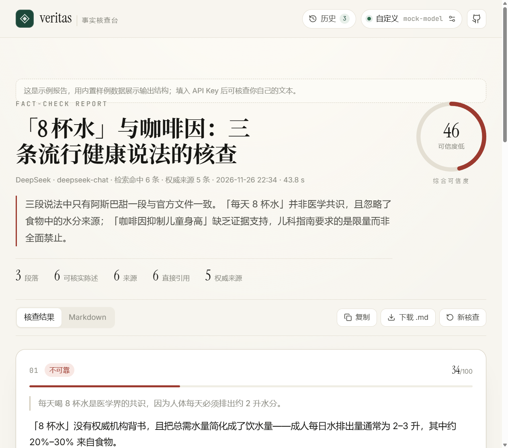
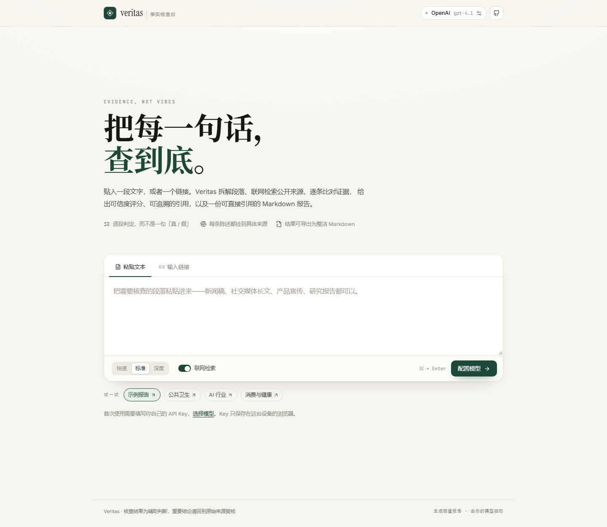
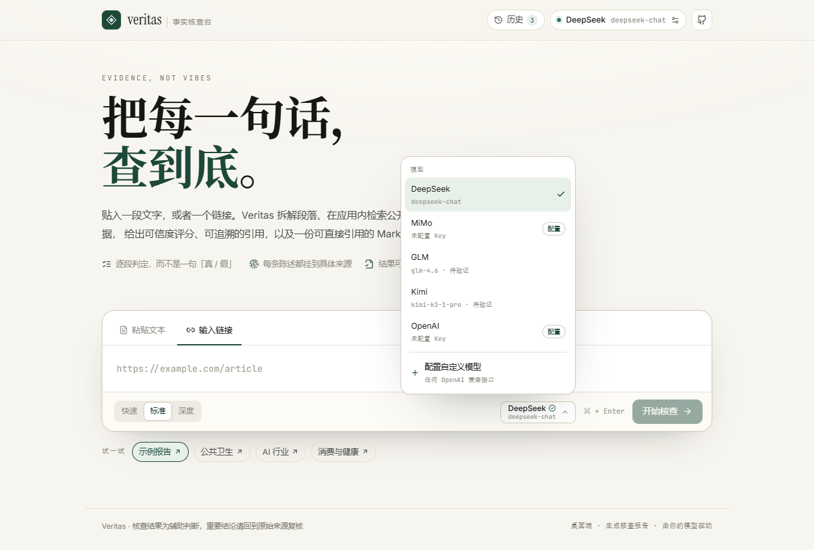

<div align="center">

# Veritas · 事实核查台

**贴入一段文字，或者一个链接。逐段取证，给出可信度与来源。**

纯本地运行 · 自带模型 Key · 无中间服务器 · 输出整洁 Markdown

[下载客户端](#下载) · [查看原理](#它是怎么核查的) · [从源码构建](#从源码构建) · [Releases](https://github.com/kkai726/veritas/releases)

[](https://github.com/kkai726/veritas/releases)
[](./LICENSE)
[](https://vite.dev)
[](https://react.dev)
[](https://www.electronjs.org)



</div>

> **这个项目不提供在线核查服务。** 网页版曾短暂上线，但浏览器直连大模型会被 CORS 拦掉、也让别人的 Key 暴露在第三方页面里，所以在线入口已下线。现在只提供 Windows / Android 客户端和可自托管的镜像，Key 始终留在你自己的机器上。`kkai726.github.io/veritas/` 是本项目的介绍页，不是应用。

---

## 它解决什么问题

大多数「AI 事实核查」只给一句判决：真、假、或者「需要更多信息」。但真实文本是混合的——同一段话里，数字可能准确，因果被夸大，引述被张冠李戴。

Veritas 不下一句话结论，它把一段话拆开看：

1. **拆段** — 按自然段切分，逐段判断是否存在可核实的事实性主张，纯观点、修辞、主观感受会被标为「无事实主张」跳过；
2. **取证** — 用你选的模型去公开来源检索（官方公告、监管文件、论文、主流媒体），要求给出可访问的 URL；
3. **比对** — 每条主张与证据并排，标成「有据支持 / 部分支持 / 缺乏证据 / 与证据矛盾 / 无法核实」；
4. **成文** — 输出可信度百分比、逐段分析、编号来源清单，以及一份可直接粘贴的 Markdown 报告。

## 下载

| 平台 | 文件 | 大小 | 说明 |
| :--- | :--- | :--- | :--- |
| Windows 10/11 x64 | [`Veritas-Setup-1.0.0-x64.exe`](https://github.com/kkai726/veritas/releases/download/v1.0.0/Veritas-Setup-1.0.0-x64.exe) | 116 MB | NSIS 安装版，可选安装目录、生成桌面快捷方式 |
| Windows 10/11 x64 | [`Veritas-Portable-1.0.0-x64.exe`](https://github.com/kkai726/veritas/releases/download/v1.0.0/Veritas-Portable-1.0.0-x64.exe) | 106 MB | 免安装单文件，双击即用，放进 U 盘也能跑 |
| Android 7.0+ (arm64) | [`Veritas-1.0.0-android.apk`](https://github.com/kkai726/veritas/releases/download/v1.0.0/Veritas-1.0.0-android.apk) | 190 KB | `minSdk 24` / `targetSdk 35`，原生 WebView 壳，不依赖 Capacitor |
| 任意 Linux / NAS | [`ghcr.io/kkai726/veritas:latest`](https://github.com/kkai726/veritas/pkgs/container/veritas) | 20 MB | Nginx 托管静态站，自托管网页版（见 [自托管](#自托管镜像)） |

安装前的两件事，都是系统层面的，不是程序问题：

- **Windows** 的这两个 exe **没有代码签名**。首次运行 SmartScreen 会拦一次，点「更多信息 → 仍要运行」；部分杀软会对未签名 Electron 包误报。
- **Android** 的 APK 用调试证书签名（`CN=Veritas, OU=Dev`），安装时需允许「未知来源」，且不能与后续正式签名的版本覆盖安装。

每个产物的 SHA-256 都写在 [v1.0.0 发布说明](https://github.com/kkai726/veritas/releases/tag/v1.0.0) 里，下载后可以自行核对。

## 界面

<div align="center">

<br />
<sub>首屏：左侧一句话，右侧一个输入卡片。粘贴文本或链接，选深度与模型，回车开始。</sub>
</div>

<br />

<div align="center">

<br />
<sub>模型下拉只列已经配好 Key 的服务商，其余收进「自定义」；配置在本地缓存，换模型不用重填。</sub>
</div>

## 支持的模型

内置六项，Key 按服务商分别缓存（`localStorage` 键 `veritas.settings.v2`），切换不丢：

| 服务商 | 默认模型 | 内置联网 | 接口地址 | 备注 |
| :--- | :--- | :--- | :--- | :--- |
| DeepSeek | `deepseek-chat` | 否 | `api.deepseek.com/v1` | 中文稳、价格低，日常核查够用 |
| MiMo | `mimo-v2.6-pro` | 否 | `api.xiaomimimo.com/v1` | 小米开放平台，OpenAI 兼容 |
| GLM | `glm-4.6` | 否 | `open.bigmodel.cn/api/paas/v4` | 中文资料与工具调用 |
| Kimi | `kimi-k3-1-pro` | 否 | `api.moonshot.cn/v1` | 长文吃得住，适合整篇核查 |
| OpenAI | `gpt-4.1` | **是**（`web_search`） | `api.openai.com/v1` | 唯一原生联网检索，能在桌面端/安卓端直连 |
| 自定义 | 自填 | 取决于网关 | 自填 | 中转站、vLLM、Ollama、企业网关、Gemini/Perplexity/OpenRouter |

模型名不限于下拉里的建议值，可以直接改成任何该服务商支持的模型 ID。**只有 OpenAI 会真的联网**：其余模型没有内置检索工具，核查只依据模型参数里的知识，报告末尾的「核查局限」会明确标出来——这是刻意保留的诚实，而不是遗漏。

## 三种运行形态

同一份前端代码，三种外壳，共用一套界面与 Key 缓存：

| 形态 | 产物 | 网络通道 | 能否直连 OpenAI |
| :--- | :--- | :--- | :--- |
| Windows 桌面 | `electron-builder` → NSIS / portable | 渲染进程 `fetch` → IPC → 主进程 `net` 请求 | **能** |
| Android | `android/build.sh` → 签名 APK | WebView `fetch` → `@JavascriptInterface` 桥 → `HttpURLConnection` | **能** |
| 静态网页 | `dist/` | 浏览器 `fetch` | 不能（CORS，见下文） |

桌面端不直接 `file://` 加载页面，而是注册了自定义 `app://` 协议托管 `dist`。原因是 `file://` 的 origin 是 `null`，`localStorage` 会被隔离甚至不可用，Key 缓存就失效了；`app://` 给了页面一个稳定 origin，缓存与网页版行为一致。

安卓端没有走 Capacitor：Gradle 与远程依赖在这台机器上只有 ~150 KB/s，索性用 `aapt2 → javac → d8 → zipalign → apksigner` 手写了一条构建链，壳子本身只有三件事——起一个只监听 `127.0.0.1` 的静态服务、用 WebView 加载它、把 JS 的请求转给 `HttpURLConnection` 再把结果回调给 `window.__veritasNativeResolve`。所以 APK 只有 190 KB，Electron 包却要 100 MB 以上。

## 它是怎么核查的

```
输入文本 / URL
   │
   ├─ URL  →  Jina Reader 取正文 → 失败则公共代理 + DOMParser 抽取
   │
   ├─ 构造指令：核查纪律 + 强度档位 + 输出 JSON Schema
   │
   ├─ 调用模型（带联网工具）→ 正文 + 服务商真实返回的引用列表
   │
   ├─ JSON 解析：容错代码围栏 / 尾逗号 / 截断 → 失败则让模型自修一次
   │
   └─ 归一化：来源去重 → 统一编号 → 段落↔来源映射 → 渲染 + 生成 Markdown
```

关键约束在 `src/lib/report.ts`：**报告里的链接只能来自服务商真实返回的检索结果，或模型明确给出的 URL**。模型负责「判断」，来源列表负责「证据」，两者在这里合并编号，避免模型自由发挥写出不存在的地址。编号冲突、同一 URL 重复出现、段落引用了不存在的来源，都会在这一步被修掉。

核查强度分三档，控制拆段数量与检索轮次：

| 档位 | 拆段上限 | 适用 |
| :--- | :--- | :--- |
| 快速 | 少 | 先看个大概，成本最低 |
| 标准 | 中（默认） | 常规文章、公众号长文 |
| 深度 | 多 | 需要逐句对账的稿件 |

## 输出长什么样

报告是结构化数据渲染出来的，同一份内容可以切到「Markdown」页直接复制或下载 `.md`：

```markdown
# 事实核查报告 · 「8 杯水」与咖啡因：三条流行健康说法的核查

> **综合可信度 46/100 — 可信度低**
> 三段说法中只有阿斯巴甜一段与官方文件一致……

| 项目 | 内容 |
| :--- | :--- |
| 段落 / 可核实陈述 | 3 段 / 6 条 |
| 判定分布 | 有据支持 2 · 部分支持 1 · 缺乏证据 1 · 与证据矛盾 2 |
| 引用来源 | 6 条 · 6 个站点 |

## 逐段核查

### 1. 可信度低 · 34/100

> 每天喝 8 杯水是医学界的共识，因为人体每天必须排出约 2 升水分。

**判定** — 「8 杯水」没有权威机构背书……

- **✕ 与证据矛盾**「每天 8 杯水」是医学界共识 — 美国国家医学院、梅奥诊所均未给出该标准 [1]
- **◐ 部分支持** 人体每天必须排出约 2 升水分 — 实际区间为 2–3 升 [2]
```

版面里的对应关系：可信度环形评分在上，段落卡按 `01 / 02 / 03` 编号，每张卡右上角是段落分，正文下方是证据条目与相关度标签，最下面是两列排布、带编号的来源卡片，最后是「核查局限」。

## 从源码构建

需要 Node.js 20+。仓库不含任何服务端代码，也不需要配环境变量。

```bash
git clone https://github.com/kkai726/veritas.git
cd veritas
npm install
npm run dev          # http://localhost:5173
```

开发态下没有原生网络桥，走的是浏览器 `fetch`，所以只能选带 CORS 头的服务商（DeepSeek / MiMo / GLM / Kimi / 自定义网关）。想验证 OpenAI，请构建桌面端。

### Windows 桌面端

```bash
npm run build            # tsc --noEmit && vite build
npm run app:win          # electron-builder --win → release/
```

产物是 `release/Veritas Setup 1.0.0.exe`（安装版）与 `release/Veritas 1.0.0.exe`（免安装）。开发时用 `npm run electron`（先构建再开窗口）。

打包时的两个环境坑，如果脚本跑不起来可以先看这里：

- 终端里若存在 `ELECTRON_RUN_AS_NODE=1`，`electron .` 会被当成 Node 进程执行并立刻退出，需要 `env -u ELECTRON_RUN_AS_NODE npm run electron`；
- `electron-builder` 默认输出 `release/`，若该目录被占用或删除受限，用 `-c.directories.output=release-win` 换个目录。

### Android

需要 JDK 17+、Android SDK 的 `build-tools;35.0.0` 与 `platforms;android-35`，不需要 Gradle：

```bash
npm run build
cd android
ANDROID_SDK=/path/to/android-sdk JAVA_HOME=/path/to/jdk-17 ./build.sh
# 产物：android/build/apk/veritas.apk（已签名，可直接 adb install）
```

脚本自己完成 `aapt2 compile/link → 写入前端资产 → javac → d8 → zipalign → apksigner`，首次运行会生成一个调试 keystore 到 `android/build/`。要出正式包，把 `build.sh` 里的 `KEYSTORE / KEYPASS` 换成你自己的 keystore 与口令。

### 自托管镜像

网页版不能直连 OpenAI，但如果只是想在内网或 NAS 上放一份给同事用，直接跑容器：

```bash
docker run -d --name veritas -p 8080:80 ghcr.io/kkai726/veritas:latest
# 打开 http://<你的机器>:8080
```

镜像由 `.github/workflows/package.yml` 在每次推 `main` 时构建：`node:20-alpine` 里 `npm ci && npm run build`，再把 `dist/` 拷进 `nginx:alpine`，附带一份禁用缓存探测、开启 gzip 的 `docker/nginx.conf`。标签有 `latest`、`main` 和 `sha-<commit>`。

## 为什么 OpenAI 会报 `Failed to fetch`

选了 OpenAI 官方接口、点「开始核查」，页面只回一句 `网络请求失败：Failed to fetch`，那基本不是 Key 的问题。在网页版里 curl 一下就能看到：

```bash
$ curl -sD - -o /dev/null -X POST https://api.openai.com/v1/responses \
    -H 'Origin: https://example.com' -H 'Authorization: Bearer sk-test' \
    -H 'Content-Type: application/json' -d '{"model":"gpt-4.1","input":"hi"}'

HTTP/2 401
access-control-expose-headers: CF-Ray
# ← 没有 access-control-allow-origin
```

浏览器只有在响应带 `Access-Control-Allow-Origin` 时才允许页面读取响应体。OpenAI 的 POST 响应只给 `Expose-Headers`，不给 `Allow-Origin`，请求在浏览器网络层就被丢弃，JS 侧只拿到一个 `TypeError`。同一条请求用 curl 或后端发都成功——所以表现为「Key 明明有效，页面永远失败」。

实测（真实浏览器环境，401 说明请求确实到达了服务商）：

| 服务商 | 浏览器直连 | 现象 |
| :--- | :--- | :--- |
| OpenAI | ✗ | POST 响应缺 `Access-Control-Allow-Origin` |
| Google Gemini | ✓ | 正常返回，支持 search grounding |
| Perplexity | ✓ | 正常返回结构化 citations |
| OpenRouter | ✓ | 正常返回，`:online` 可联网 |
| DeepSeek | ✓ | 正常返回 |

正因如此，本项目的联网检索能力放在桌面端与安卓端：请求由主进程 / 原生层发出，不受浏览器同源策略约束。网页版若要接 OpenAI，得自己在中间架一层转发（仓库里的 [`worker/`](./worker) 就是给 Cloudflare Worker 用的白名单转发，补 CORS 头，Key 只经过你自己的 Worker）。

## 隐私与安全

- **没有后端**。仓库里没有服务器、数据库、统计脚本，也没有埋点。
- **Key 只在本机**。写入 `localStorage`，请求直接发往你选的服务商，不经任何第三方。设置面板里有「清除 Key」，清除浏览器/应用数据也会一并删除。
- **报告不外传**。生成过程在本地完成，除服务商接口外没有任何出网请求；唯一例外是你粘贴链接时的正文抓取（Jina Reader 或公共代理）。
- **桌面端关闭 Node 集成**。`contextIsolation: true`、`nodeIntegration: false`，页面只能通过 preload 暴露的三个方法与主进程通信。

公开机器上使用的提醒：任何能打开这个应用的人都能读到本地保存的 Key，用完记得清除。

## 目录结构

```
src/
├─ App.tsx                 首页 / 运行态 / 报告态的状态机
├─ components/
│  ├─ Composer.tsx         输入区（文本 / 链接、强度、联网开关）
│  ├─ ModelPicker.tsx      服务商下拉，只列已配 Key 的项
│  ├─ ReportView.tsx       报告渲染（段落卡、来源、Markdown 预览）
│  ├─ SettingsDialog.tsx   BYO-Key 配置与连接测试
│  ├─ Processing.tsx       阶段进度
│  └─ ScoreRing.tsx        可信度环
├─ lib/
│  ├─ settings.ts          服务商预设、Key 缓存与迁移
│  ├─ providers.ts         请求适配、错误分类、引用解析
│  ├─ transport.ts         desktop / android / web 三条网络通道
│  ├─ prompt.ts            核查纪律与 JSON Schema
│  ├─ pipeline.ts          编排：抓取 → 调用 → 解析 → 成文
│  ├─ report.ts            来源去重、编号、段落映射
│  ├─ markdown.ts          Markdown 报告生成
│  ├─ extract.ts           链接正文抽取
│  └─ parse.ts             JSON 容错解析
└─ styles/global.css       设计令牌与组件样式

electron/                  main.cjs（app:// 协议 + IPC 网络）+ preload.cjs
android/                   build.sh 构建链、MainActivity.java（WebView 壳 + 网络桥）、图标与清单
worker/                    Cloudflare Worker 转发（浏览器直连 OpenAI 的补丁）
site/                      项目介绍页，发布到 GitHub Pages
docker/                    nginx.conf，供自托管镜像使用
```

## 已知限制

- **抓取**：部分站点有反爬、需要登录或纯前端渲染，抓取会失败（返回 4xx 或极短正文），此时请直接粘贴正文。公共代理不稳定，长期使用建议自建 Reader。
- **模型幻觉**：即便提示词反复要求「不得编造 URL」，模型仍可能给出看似合理但错误的主张判断。报告是**辅助材料**，重要结论请回到 `[1]` `[2]` 指向的原文复核。
- **未联网模型的时效**：用 DeepSeek / GLM / Kimi 时报告只基于模型知识，近期事件容易判错，文末会标注。
- **成本**：深度档会显著增加 token 与检索消耗，建议先用「快速」试跑一段。
- **平台覆盖**：Windows 只出了 x64，没有 arm64 与 macOS 包；APK 只做了 arm64 且使用调试签名；两者都未做代码签名与自动更新。

## 参与贡献

Issue 与 PR 都欢迎。加一家服务商的路子很短：在 `src/lib/settings.ts` 的 `PROVIDERS` 里加一条 `ProviderPreset`，再在 `src/lib/providers.ts` 里写一个适配器，返回 `{ text, citations, searchUsed }` 即可；如果它同样是 OpenAI 兼容的，直接落在 `custom` 分类里，连代码都不用改。

## License

[MIT](./LICENSE) © 2026 kkai726
